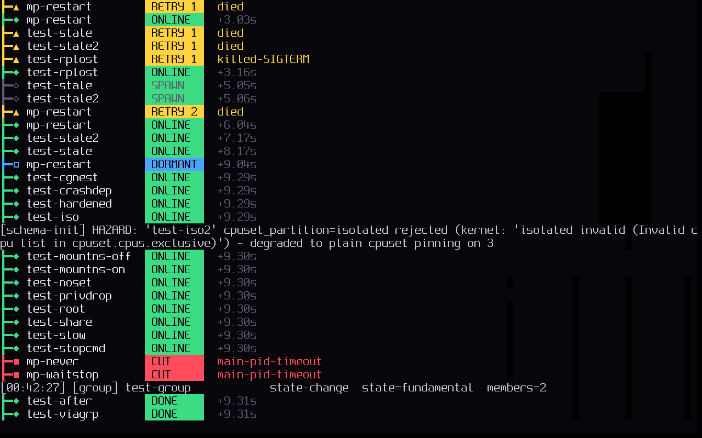

# schema-init

<p align="center">
  <a href="assets/schema-init-trailer.mp4"></a>
</p>
<p align="center"><sub>▶ 30-second trailer — <a href="assets/schema-init-trailer.mp4">watch in full resolution, with sound</a></sub></p>

## Documentation

| | |
|---|---|
| [Installing](docs/install.md) | ISO, in-place conversion, building from source, GRUB, filesystem setup |
| [How it works](docs/how-it-works.md) | The state machine, `.svc` files, states, shutdown, the shared-memory interface |
| [Service file reference](docs/svc-reference.md) | Every `.svc` key |
| [The reclaimed daemons](docs/components.md) | schema-udev, schema-doctor, schema-logind, schema-dbus, running packaged software |
| [Running a schema-init box](docs/operations.md) | `schema-ctl`, `schema-ctl verify` (will the box come back if you reboot now, and will the way back work?), the recovery console, debugging, crashes, logs, the per-user supervisor `schema-user` |
| [Numbers](docs/benchmarks.md) | Every boot, RAM, power and footprint measurement, with method and raw data |
| [Compared](docs/compared.md) | schema-init next to systemd, sysvinit, OpenRC, runit, s6, dinit, Shepherd and BusyBox init, with head-to-head boot numbers |
| [Porting and distributions](docs/porting.md) | New distros, the shipped distro configs, repository layout |
| [Roadmap](docs/roadmap.md) | What's done and what's next |
| [Why schema-init](docs/why-schema-init.md) | Who it is for, and who it is not for |

**License:** AGPL-3.0-or-later. A [commercial license](#license) is available for embedding in proprietary systems.

---

## My old machine got better

I wrote schema-init as the operating layer for Project Daedalus, the controller for the Ungulate Leg (more in [Origin](#origin)). It had to be a PID 1 I could read end to end, with none of systemd's ideas about what a computer is for. In late May 2026 I tried it on my own desktop, a Ryzen 5 1600 with 16 GB of RAM and a GTX 1050 Ti. I was already shopping for a replacement, and that box was about to become the TV computer.

Under systemd it was sluggish, slow to boot, and ran out of memory all the time. Under schema-init it became useful. schema-init frees about 400 MB of RAM or more, and with its memory-pressure handling I can run far more at once than I ever could on stock systemd.

I never bought the new machine.

The measured numbers come from a test laptop: a 2017 HP with a Celeron, 4 GB of RAM and a 5400 rpm disk. On a stock Fedora 44 KDE install, converted in place with three clicks and no tuning, **the desktop is drawn 27.5 s sooner and the machine carries 439 MB less RAM at idle**. That's the median of 3 boots per side, with the method and raw data in [Numbers](docs/benchmarks.md#fedora-44-kde-converted-in-place-stock-vs-migrated).

## What it is

A minimal PID 1 init system for Linux that supervises services through a weight-state machine instead of unit files and dependency graphs — and, increasingly, a native, auditable replacement for the systemd daemons around it.

No systemd. No OpenRC. No journal daemon. At its core, just a statically linked binary that mounts your filesystems, spawns your services in dependency order, and watches them — then gets out of the way.

**It doesn't stop at PID 1.** schema-init ships small, single-purpose, native replacements for systemd's satellite daemons, which you opt into one at a time: `schema-logind` (sessions, power, seats, plus the `hostname1`/`timedate1`/`locale1` D-Bus surfaces), `schema-systemd1` (the `org.freedesktop.systemd1` surface that `systemctl status` and Cockpit's Services page talk to), `schema-udev` (device management, authoritative over `/dev`), `schema-journal-sink` (a journald-shaped endpoint that drains to a plain logfile), and built-in `.svc` timers that retire `cron` and systemd `.timer` units. Alongside them sits `schema-dbus`, a third D-Bus broker for both the system and session bus. Each is a program you can read end to end, runs only if you list it, and backs out with a single reboot. The point isn't only *less*; it's an init layer you can actually **read, top to bottom, and own**.

**Services can be fenced in by the kernel, one key at a time.** Besides the usual `no_new_privs`, `private_tmp` and `protect_system`, a service can be held to the paths it lists (`landlock_ro=`/`landlock_rw=`) and to the TCP ports it lists: `landlock_bind_tcp=80,443` and `landlock_connect_tcp=5432` let a web server listen only on 80/443 and reach only its database, enforced by Landlock (kernel 6.7+), with no firewall and no eBPF. See [Hardening](docs/svc-reference.md#hardening).

**systemd units keep their meaning.** `schema-import` turns a packaged `.service` into a `.svc`, and that includes how the service reloads, when it restarts and how it stops. `systemctl reload sshd` sends sshd its SIGHUP instead of restarting it, `Restart=on-failure` leaves a service down after a clean exit, and `KillMode=process` means stopping sshd leaves your open sessions alone. A stop that a service ignores ends with `final_kill_signal` after its grace, so nothing hangs a `schema-ctl stop` forever. See [`exec_reload`, `restart` and `kill_mode` in the service file reference](docs/svc-reference.md).

**PID 1 footprint: 1.2 MB RSS on a minimal boot, 3.3–4.0 MB running a 47-service KDE desktop — one thread, in every case.** Every figure names the machine, the build and the service count it was measured on: see [PID 1 RSS — every measurement](docs/benchmarks.md#pid-1-rss--every-measurement).

## The rail

On a text console, the boot reads as a status display in schema-init's own font and colours: a banner, a track down the left, one line per service with a colour chip for what happened, and a finish line that counts the result.



Purple is PERFECT, green is up, yellow is a retry or a failed action, red is cut, blue is stopped or dormant, gray is waiting or exited. Every crash is one `RETRY n` line with its cause; anything broken is red or yellow, never hidden. The full plain record is in `/var/log/schema-init/rail.log`, unchanged.

- Only on a real VT in text mode. A serial console, a log file, or a Plymouth splash keeps today's plain lines.
- The font is `schema-10x20`, built on [Terminus](https://terminus-font.sourceforge.net/) (OFL-1.1) and loaded by PID 1 itself; it skips itself on screens under 1280 px wide or when `/etc/vconsole.conf` names another font. It's also installed as a normal console font: `setfont schema-10x20`, or put `FONT=schema-10x20` in `/etc/vconsole.conf` and rebuild the initramfs (`dracut -f`) to have it from the first line of boot.
- Turn it off with `schema.rail=plain` on the kernel command line or the word `plain` in `/etc/schema-init/rail`; keep the colours but not the font with `schema.rail_font=off` or `nofont`.

## Limp mode

The Ungulate Leg has a get-home mode: when a joint fails it doesn't fall over, it limps. schema-init does the same for services.

When a service fails, the recovery arc doesn't only retry it. It plays the **cards** the service's `.svc` declares, cheapest first, one per retry:

```ini
name=camera-stream
exec=/usr/bin/camera-stream
card=exec:/usr/bin/camera-reset --usb      # run as root before the next try
card=fallback:camera-stream-lowres         # give up for now, run the degraded service instead
```

- **`card=exec:CMD`** runs a fix-up command (reset a device, clear a stale cache) in its own process, and the service waits for it before trying again.
- **`card=fallback:SVC`** names a standby service that does the job in a reduced way. It sits idle until the card is played, then runs while the main service is parked, and is stopped again before the main service gets its next try. If the main service never comes back, the standby keeps going.

Each card is played once; the deck starts over after the service has run for 5 minutes. Nothing here can lose work behind your back: cards are only what the service file declares.

**The board** (`schema-board`) shows it live: every service's state in the leg's LED colours, which card it is on, which service is limping and which one is standing in for it. It runs on its own console, drawn in the boot rail's look, and keeps working when the desktop has frozen. See [`card=` in the service file reference](docs/svc-reference.md) and [the recovery console](docs/operations.md#recovery-console).

## Flight recorder

When something dies without a service failing (a runaway process pins the CPU, the kernel runs out of memory, the desktop session drops you to a console), every service can still look green. `schema-recorder` keeps a short rolling record of what happened and the board shows the latest line, for example `desktop session ended - CPU pinned 20 min by cosmic-player x8`. It is opt-in. PID 1 only sends it a short message per event. On a real desktop the recorder uses about 0.2–0.3 MB (PSS) and doesn't wake up while nothing is happening; boot time and PID 1 memory didn't change across 6 reboots on two machines:

```sh
sudo cp /usr/share/schema-init/services/schema-recorder.svc.example /etc/schema-init/services/schema-recorder.svc && sudo schema-ctl add schema-recorder
schema-ctl trace                 # what happened
schema-ctl trace --since 21:00   # from a time (or an epoch) onward
```

To record earlyoom kills too, run it with `-N /usr/local/bin/schema-recorder-earlyoom`. See [the flight recorder in the operations guide](docs/operations.md#flight-recorder).

## Restarting the D-Bus broker

`schema-dbus` hands its sockets and client connections to PID 1 before it stops, then picks them up again, so `sudo schema-ctl restart dbus` no longer drops every client on the bus. Any service can do the same with `fdstore=N`. See [the descriptor store in the operations guide](docs/operations.md#descriptor-store-fdstore).

Mostly you won't need to restart it: like `dbus-daemon`, it picks up new or changed D-Bus config on its own, so a `dnf` transaction that installs a service's bus policy takes effect without a restart or a reboot. See [config changes apply live](docs/components.md).

## Try it

Your existing boot entries (systemd, or the stock init on Devuan, Void or Artix) stay in the GRUB menu, and you can back out with one reboot at every step.

| You want to… | Do this | What it touches |
|---|---|---|
| Try it without risking a disk | [Build, test, boot it in a VM](docs/install.md#build-from-source-any-distro) — or boot the installer ISO in a VM | Nothing on your machine |
| Put it on a spare machine | [Install from the ISO](docs/install.md#fresh-install--the-installer-iso) | The disk you pick in the installer |
| Convert your Fedora KDE install | [COPR + `schema-migrate`](docs/install.md#convert-fedora-kde-in-place) | Adds a non-default boot entry; one command undoes it |
| Run it on Devuan (no systemd) | [`distros/devuan`](distros/devuan/README.md): `make` + `install.sh`, beside sysvinit | Adds a non-default boot entry; `install.sh --remove` undoes it |
| Run it on Void (no systemd) | [`distros/void`](distros/void/README.md): `make` + `install.sh`, beside runit | Adds a non-default boot entry; `install.sh --remove` undoes it |
| Run it on Artix (no systemd) | [`distros/artix`](distros/artix/README.md): `make` + `install.sh`, beside dinit, s6 or OpenRC | Adds a non-default boot entry; `install.sh --remove` undoes it |
| Run it on a Raspberry Pi | [`distros/raspberry-pi`](distros/raspberry-pi/README.md): apt repo (`armhf`, `arm64`), `schema-pi enable` | Edits `cmdline.txt`; `schema-pi disable` undoes it, boot fallback to systemd |
| Run it on another distro | [`setup.sh` from source](docs/install.md#build-from-source-any-distro) | Adds a non-default boot entry |

On Fedora KDE the short version is:

```sh
sudo dnf upgrade --refresh && sudo reboot
sudo dnf copr enable ajax80/schema-init
sudo dnf install schema-init-wizard
```

then run `schema-wizard`. It walks you through three reversible stages with a rollback at each one. Upgrade and reboot first: on a fresh-from-the-image install the wizard's Qt dependency pulls half of KDE forward, and that partial upgrade can fail on Fedora package conflicts; the reboot puts you on the new kernel, which is the one the schema boot entry is made for. `schema-migrate` refuses to profile or deploy while the default boot entry is not the running kernel.

## Known limitations

These are real gaps, not future features being teased:

- **Young, and not independently audited — but audited as far as we can take it ourselves.** `schema-dbus` and `schema-logind` sit on the system's authorization boundary — who may own a bus name, who may power off, who gets device access. Here is what has been done:
  - Every change lands test-first with a code-review pass. CI runs the C test suite, again under AddressSanitizer and UndefinedBehaviorSanitizer, and the Python integration suite, plus fuzz harnesses and CodeQL.
  - An AI-assisted security review of the D-Bus and logind daemons (Nov 2026) found and fixed missing polkit gates, unenforced D-Bus receive policy and socket-permission races.
  - A security audit of `schema-import` (Nov 2026) fixed silent sandbox loss, ignored drop-ins and secrets copied world-readable ([#477](https://github.com/ajax80/schema-init/pull/477)).
  - A read-only audit of every C source, the Python daemons' authorization paths, the shim, the importer and CI (Nov 2026; [spec](docs/superpowers/specs/2026-11-12-full-audit-spec.md)) was worked through tier by tier.
  - A second AI model (ChatGPT) reviewed master cold; each claim was checked against the code, and the seven that held up were fixed ([#565](https://github.com/ajax80/schema-init/pull/565)–[#568](https://github.com/ajax80/schema-init/pull/568)).

  That is as far as our own auditing goes. Every review above was done by the author or by AI tools he directed; none is a professional outside security review. Weigh that before running these daemons on a machine other people log into. To report a vulnerability, see [SECURITY.md](SECURITY.md).
- **Parts of it are Python.** PID 1, `schema-ctl`, `schema-udev`, `schema-dbus` and `schema-journal-sink` are C. `schema-logind` (with the `hostname1`/`timedate1`/`locale1` D-Bus surfaces), `schema-systemd1`, `schema-doctor`, `schema-import` and the migration wizard are Python 3 using dbus-python and PyGObject. If you opt into those, Python is part of your boot, with the memory and start-up cost that brings.
- **systemd compatibility is a translator, not systemd.** There is no unit-file engine. `schema-import` carries the directives listed in [Running packaged software](docs/components.md#running-packaged-software) into native `.svc` keys, and anything it can't carry faithfully is logged and skipped, never half-translated. The `systemctl` shim and the `org.freedesktop.systemd1` D-Bus surface answer the calls packages and desktops actually make; they are not the whole systemd API. Check that what a unit needs is on those lists before relying on it.
- **Syscall filtering is opt-in and new.** `syscall_filter=` and `syscall_deny=` (seccomp, Nov 2026) apply only to services that set them — the host hardening-default switch does not turn them on — and are tested natively on x86_64 and arm64 in CI, not yet on real armhf hardware. `SystemCallArchitectures=` imports as native-only: a filtered service cannot make foreign-arch syscalls, and no other architecture list is honoured.
- **`schema-logind.py` reimplements a subset of `org.freedesktop.login1`.** It models multiple concurrent sessions and seats — a session registry with one object per session, per-seat membership, and active-session tracking — which is enough for a Wayland compositor to take KMS and hand it back on a VT switch (see [Recovery console](docs/operations.md#recovery-console)) and for `uaccess` device ACLs to follow the active session. It is a targeted reimplementation, not the full daemon. It also does not set `KDSKBMODE = K_OFF`, deliberately — if the daemon died while `K_OFF` were set the console keyboard would stay dead, and `K_OFF` would also disable the kernel's ctrl-alt-F<n> VT switch that is the recovery-console escape hatch — so keystrokes still reach the tty underneath a compositor. They are neutralised rather than blocked: when the session VT is handed to the compositor, echo is turned off and pending input is flushed, and no getty runs on the session VT to read what arrives.

---

## Origin

schema-init was built by Jonathan Ayers in 2026 as the operating layer for the **Ungulate Leg** — an exoskeleton controller that needs a deterministic, schema-driven PID 1 carrying none of systemd's assumptions about what a computer is for. (A sister project, the **Samara Wing**, applies the same architecture to flight.) The reference hardware that proved it — a pawn-shop Dell Inspiron named Eli — booted to a full desktop under schema-init on May 30th, 2026. It was written alongside Claire, an AI (Claude, by Anthropic) that held continuity across the work.

---

## License

**AGPL-3.0-or-later** for open source use — full text in [LICENSE](LICENSE).  
Commercial license available for embedding in proprietary systems — open an issue or contact via GitHub.

Contributions are welcome; see [CONTRIBUTING.md](CONTRIBUTING.md). The people behind it are in [CONTRIBUTORS.md](CONTRIBUTORS.md).

---

*Built by Jonathan Ayers. The schema was written before the code.*
